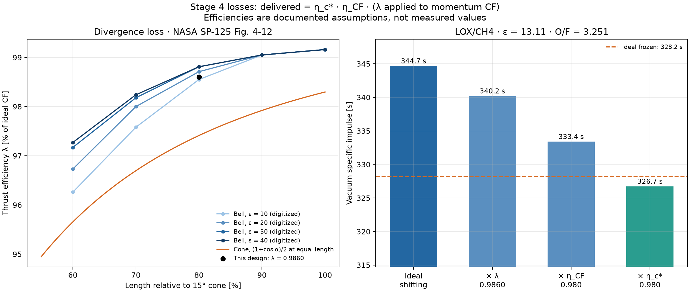
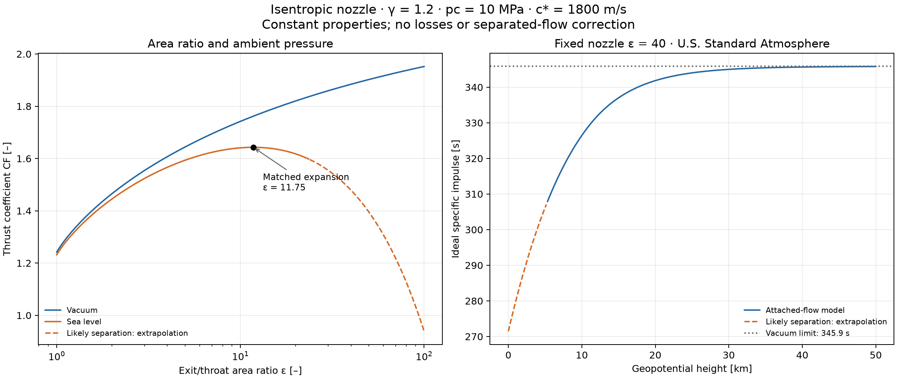
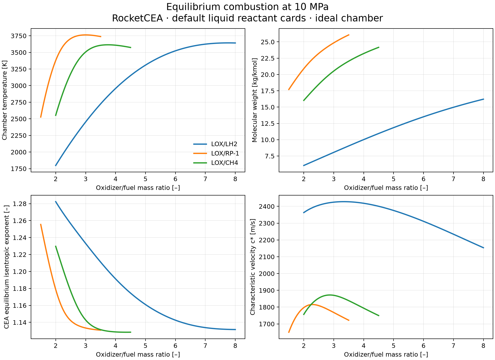

# Liquid rocket engine design

Stage 4 complete: SI thermochemistry, O/F optimization, a constant-gamma
isentropic nozzle model with separation screening, requirements-driven
engine sizing with a Rao parabolic bell contour, and delivered performance
with divergence, combustion and nozzle efficiencies plus a frozen-vs-shifting
comparison. Cooling and real-engine validation are not implemented yet.








At 10 MPa, the nominal LOX/LH2 (O/F=6), LOX/RP-1 (O/F=2.5), and
LOX/CH4 (O/F=3.5) cases give c* of 2310.99, 1808.88, and 1838.44 m/s.
The constant-gamma approximation differs by +0.0057%, −0.0486%, and
−0.0638%, respectively. These are computed ideal-model results, not measured
engine data. Agreement at these points does not establish a universal error bound.

## Run

Python 3.11+ is required. Building RocketCEA from source requires a Fortran
compiler; this project was tested with Python 3.14.4 and gfortran on macOS.

```bash
python3 -m venv .venv
source .venv/bin/activate
python -m pip install -e '.[dev,cea]'
python -m pytest -q
python examples/stage1_combustion.py
python examples/stage2_nozzle.py
python examples/stage3_sizing.py
python examples/stage4_losses.py
```

The example regenerates PNG and SVG plots in `figures/` and prints nominal
cross-checks, optimum mixture ratios, and counts of out-of-band sweep samples.
CEA integration tests skip if the optional backend is missing; a complete
Stage 1 check requires the `cea` extra and no skipped integration tests.

```python
from engine_design.thermo import chamber_props, sweep_OF, optimal_OF

props = chamber_props("LOX/CH4", p_c_Pa=10e6, OF=3.5)
print(props.T_c_K, props.c_star_m_s)
print(props.chamber_transport.mu_Pa_s)

sweep = sweep_OF("LOX/CH4", 10e6, [3.0, 3.25, 3.5, 3.75])
best_of = optimal_OF("LOX/CH4", 10e6, eps=40, condition="vacuum")
```

## Model choices and limits

- `chamber_props` assumes an adiabatic, infinite-area equilibrium combustion
  chamber and isentropic expansion. Default reactant cards include inlet
  temperatures and enthalpies. O/F is an oxidizer-to-fuel **mass** ratio.
- `frozen=True` freezes composition at the chamber for expansion; it does not
  turn off equilibrium combustion. Chamber and throat transport use the same
  chemistry mode as the flow. The reported equilibrium gamma is CEA's
  isentropic exponent, which need not equal cp/cv in a reacting mixture.
- Molecular weight is in kg/kmol. All returned dimensional quantities are SI.
  CEA transport Cp is in thermochemical cal/(g K), so we explicitly multiply
  by 4184. This avoids the wrapper's 4186.8 IT-unit conversion. Viscosity and
  conductivity conversions are also explicit in `constants.py`.
- RocketCEA 1.2.3's `get_Throat_Transport(frozen=1)` selects frozen transport
  coefficients at the **equilibrium flow state**. Our small backend adapter
  runs chamber-frozen flow explicitly before copying its transport outputs.
  The package version is pinned and frozen-state tests cover this behavior.
- `eps=None` uses a computational exit ratio of 40. Chamber and throat
  properties are independent of this choice, as checked by tests.
- Optimization holds the supplied area ratio fixed and searches the intervals
  in `constants.py`. Override with `OF_bounds=(low, high)`; boundary maxima
  issue a warning. At 10 MPa and eps=40, computed vacuum optima are O/F=4.7592
  (LH2), 2.7677 (RP-1), and 3.4413 (CH4).
- Sea-level optimization subtracts the ambient pressure-thrust penalty from
  CEA vacuum Isp. It assumes attached flow and always warns that separation
  must be checked with `nozzle.separation_check`. No separation correction is silently applied.
- Spec c* and gamma bands describe nominal equilibrium conditions. Wide
  sweeps intentionally include off-design mixtures; falling outside a band
  emits `ThermoWarning`, not a solver failure. Frozen chemistry can also fall
  outside these equilibrium bands. Invalid inputs and nonphysical CEA outputs
  are rejected separately.
- CEA uses shared Fortran state. This interface serializes its calls and uses
  temporary scratch files. Do not run unrelated direct RocketCEA calls
  concurrently in the same process.

## Checks and physics

Tests include a perfect-gas hand calculation, published RocketCEA examples,
nominal sanity bands, the 2% c* cross-check, chamber/throat independence from
exit ratio, transport-unit identities, frozen composition and cp/gamma
consistency, invalid inputs, and optimization against a dense grid.

Characteristic velocity c* measures chamber performance independently of exit
area ratio: c*=p_c A_t / mass-flow rate. Fuel-rich mixtures can improve specific
impulse by reducing exhaust molecular weight, despite not maximizing flame
temperature; the optimum balances temperature, composition, and expansion.
A constant-gamma formula approximates CEA, which allows properties and
composition to evolve along an equilibrium expansion.

## References and next stages

- [RocketCEA functions](https://rocketcea.readthedocs.io/en/latest/functions.html)
- [RocketCEA published examples and transport units](https://rocketcea.readthedocs.io/en/latest/std_examples.html)
- [RocketCEA QuickStart reference value](https://rocketcea.readthedocs.io/en/latest/quickstart.html)
- [NIST SI conversion factors](https://www.nist.gov/pml/special-publication-811/nist-guide-si-appendix-b-conversion-factors/nist-guide-si-appendix-b8)
- NASA RP-1311, Gordon and McBride, Chemical Equilibrium with Applications.
- Sutton & Biblarz, *Rocket Propulsion Elements*, 9th ed., Chapters 3 and 5.

The specifications are in `docs/spec/`.
Next is Stage 5 (cooling). Each stage requires review before the next.
Stage 7 includes GitHub publication and deployment of the Streamlit app with a
live demo link. Neither publishing nor deployment has happened yet.

## Stage 2 nozzle model

`nozzle.py` implements `mach_from_area_ratio`, `area_ratio`, `pressure_ratio`,
`thrust_coefficient`, `isp`, `optimal_eps`, and `separation_check`. All inputs
are scalar SI values or dimensionless ratios. Every physics function states
its equation, assumptions, and reference in its docstring.

```python
from engine_design.nozzle import optimal_eps, thrust_coefficient, isp

# Analyst-selected perfect-gas example, not measured engine data.
eps = optimal_eps(gamma=1.2, p_c=10e6, p_a=101325)
cf = thrust_coefficient(gamma=1.2, eps=eps, p_c=10e6, p_a=101325)
print(eps, cf, isp(c_star=1800, CF=cf))
```

For gamma=1.2 and chamber pressure 10 MPa, sea-level matched expansion gives
an area ratio of 11.75272. The demonstration nozzle at area ratio 40 gives
exit Mach 4.23940, exit pressure 20.874 kPa, and vacuum CF=1.884275.
Its sea-level result triggers the separation warning: the plotted dashed
segment is an attached-flow extrapolation and must not be interpreted as
actual separated-nozzle performance.

The nozzle assumes steady, choked, shock-free, one-dimensional perfect-gas
flow with constant gamma. This is a stronger simplification than frozen CEA,
which still permits heat capacities to vary with temperature. The example
uses an explicitly assumed gamma and c* rather than silently treating CEA's
equilibrium isentropic exponent as a frozen heat-capacity ratio.

`optimal_eps` matches exit pressure to ambient pressure. It rejects vacuum
because there is no finite ideal optimum, and rejects ambient pressures above
the sonic pressure because no matched supersonic solution exists. An area
ratio of exactly one returns sonic Mach one. The supersonic inverse uses a
bracketed root solver and logarithmic residuals.

The Summerfield default of 0.4 is a coarse warning criterion. NASA TM-77396
explains its limitations and pressure-ratio dependence; it is not a nozzle
stability or side-load model. A negative flag is not proof of attached flow.
The thrust equation retains signed results, including negative values for
extreme overexpansion, rather than disguising extrapolation by clipping.

`atmosphere.ambient_pressure` supports the altitude plot using the first five
layers of the U.S. Standard Atmosphere, 0–51 km **geopotential** height. Its
base pressures are propagated continuously from sea level. It uses the
historical gas constant specified by that atmosphere model, independently
of the thermochemistry constant. It is not a weather prediction.

Stage 2 verification includes the textbook M=2, gamma=1.4 area ratio of
1.6875; the two explicitly labeled vacuum limits on the Sutton-derived
MIT chart; an independent thrust reconstruction from throat mass flux and
exit velocity; matched-expansion optimality; pressure-thrust penalties;
separation thresholds; sonic and vacuum boundaries; and published atmosphere
pressures. The full suite has 83 passing tests, including Stage 0 and Stage 1.
The chart-limit checks use the precision of the printed labels, not an
invented high-precision digitization of the plotted curves.

- [NASA rocket thrust equations](https://www.grc.nasa.gov/WWW/k-12/airplane/rktthsum.html)
- [MIT 16.50 Lecture 7, p. 3: charts after Sutton & Biblarz (2001)](https://ocw.mit.edu/courses/16-50-introduction-to-propulsion-systems-spring-2012/e2035e49d0312366d0772766f594b671_MIT16_50S12_lec7.pdf)
- [NASA TM-77396, eq. 7: Summerfield separation guideline](https://ntrs.nasa.gov/api/citations/19840011402/downloads/19840011402.pdf)
- [NASA/TM-2005-213659, Appendix A: standard atmosphere](https://ntrs.nasa.gov/api/citations/20050207438/downloads/20050207438.pdf)

## Stage 3 sizing and contour

```python
from engine_design import EngineRequirements, design_engine

req = EngineRequirements(propellants="LOX/CH4", thrust_N=100e3,
                         thrust_condition="vacuum", p_c_Pa=10e6,
                         mixture_ratio=None, nozzle="sea_level_optimized",
                         p_amb_Pa=101325)
eng = design_engine(req)
print(eng.summary())
eng.plot_contour()
```

For the brief's example, this gives the following results:
- O/F=3.2505 and ε=13.106, matched to 101.325 kPa.
- Ideal shifting c*=1857.7 m/s, CF_vac=1.8195 and Isp_vac=344.7 s.
- Delivered Isp_vac=326.7 s, using the Stage 4 losses.
- Dt=85.06 mm, De=307.92 mm, ṁ=31.21 kg/s.
- Overall length 651 mm, of which the bell is 333 mm.

These are model outputs for a hypothetical engine, not hardware data.
Since Stage 4, the throat is sized so that delivered thrust meets the
requirement, so the dimensions are slightly larger than in the Stage 3 review.

**One performance model for selection and sizing.** Ideal CF comes from CEA
equilibrium (shifting) expansion, CF_vac = Isp_vac·g0/c*, with
CF_amb = CF_vac − ε·p_a/p_c. `optimal_OF` maximizes the same quantity, so
the chosen mixture ratio and the sized throat are consistent. The throat follows
from A_t = F/(CF_del·p_c), using the delivered CF at the requirement's
thrust condition (Stage 4).
A sea-level-optimized nozzle uses CEA's ε for p_e = p_amb
(`thermo.matched_eps`), not the constant-gamma `nozzle.optimal_eps`.
The Stage 2 formula remains an independent check. With frozen
chemistry and the frozen chamber gamma, the two CF values agree within 0.5%
at ε=13; the remaining difference comes from variable heat capacity.

**Coupled O/F and ε.** With an automatic mixture ratio and a matched nozzle,
the best O/F depends on ε, and the matched ε depends on O/F. The design
alternates the two one-dimensional problems until O/F changes by less than
1e-4. At the fixed point, O/F maximizes Isp at its own matched ε; a test
confirms this. The O/F is optimized for Isp at the thrust condition.

**Chamber.** V_c = L*·A_t, and V_c includes everything upstream of the throat:
the cylinder, a 0.5·Rt fillet, the 30° cone and the 1.5·Rt throat arc.
The cylinder length is solved to supply the remaining volume.
L* defaults come from NASA SP-125 Table 4-1 (midpoints). LOX/CH4 is an
explicit spec assumption, 1.1 m. The contraction ratio defaults to 4.
The fillet, CR and convergence angle are analyst choices in `constants.py`.

**Bell.** A 0.382·Rt downstream throat arc runs to θ_n, followed by a
quadratic Bézier (a rotated parabola) to θ_e at the exit. Its control point is
the intersection of the two endpoint tangents, which makes the slope continuous.
Bell length is 80% of a 15° straight cone, (Re−Rt)/tan 15°.
θ_n and θ_e are linearly interpolated from this project's manual
digitization of NASA SP-125 Fig. 4-14, which is retained at
`docs/references/rao_sp125_figure4-14.png`. The digitization is read to about ±0.5°.
The chart covers only 5 ≤ ε ≤ 50 and 60–100% bell length. Outside that range,
the user must supply wall angles; values are never extrapolated. This is Rao's
parabolic approximation, not a method-of-characteristics optimization.

**Separation.** The Summerfield check runs at p_amb. It warns only when
the thrust requirement is at that pressure; for vacuum designs it is reported
in the summary without a warning.

Stage 3 tests cover:
- hand-calculated A_t, ṁ and the flow split, and F = CF·p_c·A_t recomputed
- exit and chamber radii from ε and CR, with the minimum radius at x=0
- C⁰ and C¹ continuity at every joint
- bell end slopes equal to tan θ_n and tan θ_e, throat arcs that are true circles, and bell length = 80% of the cone
- volumes checked independently with exact cylinder and frustum formulas
- Rao table nodes, bilinear interpolation and no extrapolation
- matched p_e = p_amb, the coupled-optimum consistency, separation warnings and invalid inputs


- [NASA SP-125, Liquid Rocket Engine Nozzles, §4.3, Table 4-1, Figs. 4-13/4-14](https://ntrs.nasa.gov/api/citations/19710019929/downloads/19710019929.pdf)
- Rao, G. V. R., "Exhaust Nozzle Contour for Optimum Thrust," *Jet Propulsion* 28 (1958).

## Stage 4 losses

Delivered performance applies three factors to the ideal shifting-equilibrium
result (theory section 4):

- **Divergence, λ.** This factor applies to the *momentum* part of CF only:
  CF_vac,del = η_CF·(λ·CF_mom + ε·p_e/p_c), with CF_mom = CF_vac − ε·p_e/p_c.
  - For a cone, λ = (1+cos α)/2, so λ(15°) = 0.98296 (SP-125 eq. 4-8).
  - For a Rao bell, λ is interpolated from this project's digitization of NASA
    SP-125 Fig. 4-12 (bell length 60–100%, ε 10–40). The source image is at
    `docs/references/sp125_figure4-12.png`.
  - The digitization located curve centres from the pixels of a 600-dpi render.
    It was checked against the chart's own conical curve, which the cone formula
    predicts independently. All five points agree within 0.06 percentage points,
    including the 15° point (98.28% read vs 98.30% from the formula).
  - Outside the chart, or when you supply wall angles, you must also supply
    `divergence_factor`. Values are never extrapolated.
- **Combustion efficiency.** η_c* = 0.98 is the spec default; SP-125's
  LOX/RP-1 sample calculation uses 0.975. It lowers c* and Isp. At fixed p_c and
  A_t it does **not** lower thrust, because F = CF·p_c·A_t. Instead it raises the
  mass flow needed, ṁ = p_c·A_t/(η_c*·c*).
- **Nozzle efficiency.** η_CF = 0.98, the midpoint of the spec's 0.97–0.99,
  covers losses other than divergence (boundary layer, kinetics).

Both efficiencies are assumptions in `constants.py`, and each design can
override them. Setting all three factors to 1 gives the ideal design back
exactly; a test confirms this.

**Ambient pressure term.** The −ε·p_a/p_c term is an exact pressure force on
the exit area, so it is subtracted *after* the efficiencies. In vacuum this
reduces to the spec's Isp_del = η_c*·η_CF·Isp. At sea level it avoids scaling
the ambient force by a flow loss.

**Sizing on delivered values.** The throat is sized so that delivered thrust meets
the requirement. For the example engine, losses enlarge A_t by 3.4%
(CF_ideal/CF_del) and ṁ by 5.5% (also ÷η_c*).

**Frozen vs. shifting.** CEA is run both ways and reported side by side.
Shifting equilibrium recombines dissociated species during expansion, releasing
chemical energy into the flow. Frozen expansion keeps the chamber composition,
so that energy is never recovered. In the example, the ideal vacuum Isp is
328.2 s frozen and 344.7 s shifting; a real nozzle falls between the two.
The delivered value (326.7 s) is computed from shifting, so the losses are
stated explicitly rather than hidden inside a frozen assumption.
It can therefore fall below ideal frozen.

O/F optimization uses ideal shifting Isp. Constant efficiencies do not move
the optimum, but the way λ varies with ε is not included in that search.

Stage 4 tests cover:
- λ(15°) ≈ 0.983, and the digitization calibrated against the chart's own cone curve
- the bell table nodes and interpolation, the bell-better-than-cone and longer-is-better trends, and no extrapolation
- a hand calculation of the momentum/pressure split and the efficiencies
- identity at unit efficiencies, and delivered < ideal
- frozen < shifting for all three propellant pairs
- an independent check of the CEA momentum split from exit Mach × sound speed
- sizing on delivered values (A_t ∝ 1/CF_del, ṁ ∝ A_t/η_c*)

The full suite has 143 passing tests.
