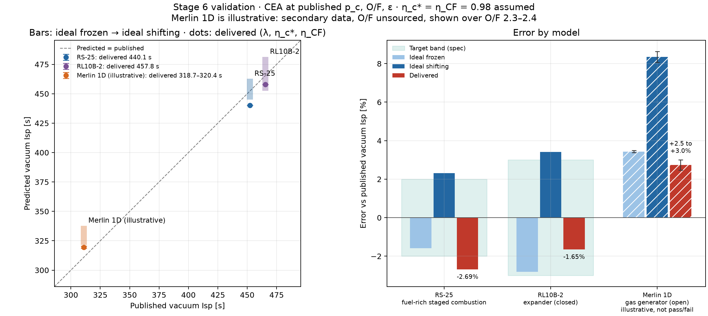
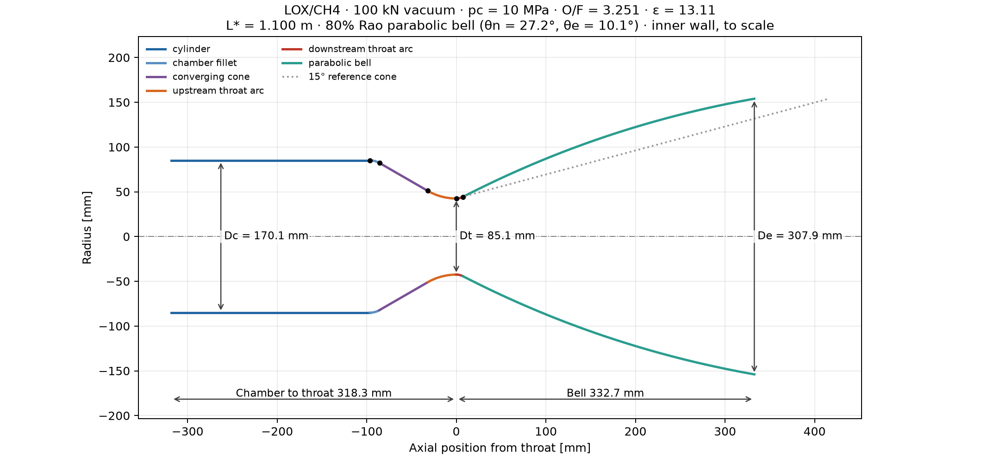
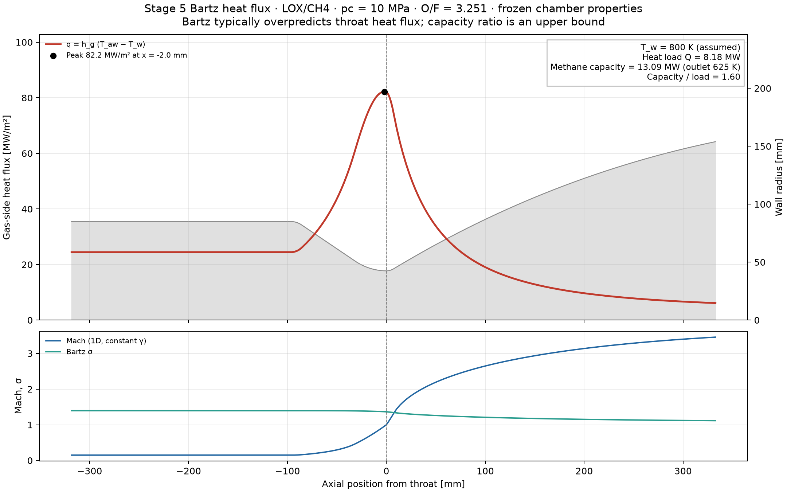

# Liquid rocket engine design

**Live app: [rocket-engine-design.streamlit.app](https://rocket-engine-design.streamlit.app/)** &nbsp;·&nbsp; **Run locally:** `streamlit run app.py`

A Python tool that designs a liquid bipropellant rocket engine from top-level
requirements (thrust, propellants, chamber pressure, nozzle) and validates the
performance model against the RS-25, RL10B-2 and Merlin 1D. It is 0D/1D and
transparent by design: NASA CEA thermochemistry, isentropic nozzle theory, a Rao
bell contour, explicit loss factors and Bartz heat transfer. Every equation is
in a docstring with its source, and every empirical number lives in
[`constants.py`](src/engine_design/constants.py) with a citation.

## Validation results

Each engine is run at its published chamber pressure, O/F and area ratio with
the same generic efficiencies (η_c* = η_CF = 0.98). Nothing is tuned to fit.

| Engine | Published Isp_vac | Predicted (frozen) | Predicted (shifting) | Delivered (with η) | Error | Target |
|---|---|---|---|---|---|---|
| RS-25 (staged combustion) | 452.3 s | 445.1 | 462.8 | 440.1 | −2.69 % | ±2 % ❌ |
| RL10B-2 (expander) | 465.5 s | 452.4 | 481.4 | 457.8 | −1.65 % | ±3 % ✅ |
| Merlin 1D (gas generator)* | 311 s | 321.5–321.8 | 336.1–337.9 | 318.7–320.4 | +2.47 to +3.01 % | illustrative |

\*The Merlin is **illustrative, not a pass/fail validation**: no primary source
gives its chamber pressure, O/F or area ratio, and no source at all gives its
O/F, so it is shown as a band over O/F = 2.3–2.4.



What the comparison shows:
- **The ideal model is in the right place for all three engines**: ideal
  shifting equilibrium is above every published Isp, as it must be.
- **Real engines sit between frozen and shifting expansion** (RS-25, RL10B-2):
  recombination during expansion releases chemical energy, but the flow
  partly freezes as the density drops.
- **The RS-25 misses its band because the generic losses are too large for it,**
  not because the thermochemistry is off. Its published Isp is 97.7 % of ideal
  shifting; the default losses allow 95.1 %. A staged-combustion engine burns
  pre-gasified propellant very completely; η_c* ≥ 0.987 would bring it inside ±2 %.
- **The Merlin's published Isp is below even ideal frozen**: the signature of a
  gas-generator cycle, which dumps turbine exhaust at low Isp. This model
  predicts the main chamber only.
- **Efficiencies dominate the uncertainty.** ±1 % in η_c* moves Isp by about
  ±4.5 s, while ±5 % in chamber pressure moves it by less than 0.1 s.

Full tables, sensitivities and data sources: [validation/results.md](validation/results.md),
[validation/engines.yaml](validation/engines.yaml) and [Validation details](#validation-details).

## Example design

The brief's example: **100 kN vacuum thrust, LOX/CH4, 10 MPa, sea-level-optimized nozzle.**

```python
from engine_design import EngineRequirements, design_engine

eng = design_engine(EngineRequirements(propellants="LOX/CH4", thrust_N=100e3,
                                       thrust_condition="vacuum", p_c_Pa=10e6,
                                       mixture_ratio=None, nozzle="sea_level_optimized",
                                       p_amb_Pa=101325))
print(eng.summary())
eng.plot_contour(); eng.plot_heat_flux()
```

| Quantity | Value |
|---|---|
| O/F, ε | 3.2505 (optimized), 13.106 (matched to 101.325 kPa) |
| Isp_vac: ideal frozen / shifting / delivered | 328.2 / 344.7 / 326.7 s |
| c* ideal, CF_vac ideal | 1857.7 m/s, 1.8195 |
| Throat / exit diameter | 85.06 / 307.92 mm |
| Mass flow | 31.21 kg/s (23.87 ox / 7.34 fuel) |
| Overall length (bell) | 651 mm (333 mm, 80 % of a 15° cone) |
| Peak heat flux | 82.2 MW/m², 0.05·R_t upstream of the throat |
| Wall heat load, methane capacity / load | 8.18 MW, 1.60 (upper bound) |

These are model outputs for a hypothetical engine, not hardware data.





## Quick start

Python 3.11+. RocketCEA builds from source on macOS and Linux and needs a
Fortran compiler (tested with Python 3.14.4 and gfortran on macOS).

```bash
python3 -m venv .venv
source .venv/bin/activate
python -m pip install -e '.[dev,cea,app]'
python -m pytest -q                     # 191 tests
streamlit run app.py                    # web app
python validation/run_validation.py     # validation table and plot
python examples/stage1_combustion.py    # ... through stage5_cooling.py: every figure
```

**Web app.** The sidebar takes propellants, thrust and thrust condition, chamber
pressure, O/F (optimized or fixed), nozzle (matched or fixed ε), efficiencies,
wall temperature and chamber geometry. Tabs show the summary table, the contour,
the heat flux, CF and Isp curves, the loss breakdown, a comparison with the real
engines, and CSV/JSON downloads. The app contains no physics of its own.
Outside the digitized charts it asks for wall angles and λ instead of
extrapolating. `requirements.txt` and `packages.txt` (gfortran) are prepared for
Streamlit Community Cloud.

## Method

### 1. Combustion ([thermo.py](src/engine_design/thermo.py))
- NASA CEA through RocketCEA: adiabatic, constant-pressure equilibrium
  combustion with an infinite-area chamber, then isentropic expansion. Default
  reactant cards set inlet temperatures and enthalpies. O/F is a **mass** ratio.
- `frozen=True` freezes composition from the chamber on; combustion itself stays
  equilibrium. CEA's equilibrium γ is an isentropic exponent, not cp/cv.
- Ideal c* from the perfect-gas formula agrees with CEA's within 0.07 % at the
  nominal points (LOX/LH2 2310.99, LOX/RP-1 1808.88, LOX/CH4 1838.44 m/s at 10 MPa).
- `optimal_OF` maximizes Isp at fixed ε. The optimum is fuel-rich of
  stoichiometric: a lighter exhaust raises exhaust velocity more than the lower
  flame temperature costs.
- Unit handling is explicit: CEA transport c_p is in thermochemical cal/(g K),
  converted with 4184 (not the wrapper's 4186.8). RocketCEA 1.2.3's frozen throat
  transport reads the equilibrium state, so the adapter runs the frozen case itself.

### 2. Nozzle ([nozzle.py](src/engine_design/nozzle.py))
- Steady, 1D, isentropic, constant-γ choked flow: area–Mach relation (subsonic
  and supersonic branches, bracketed root finder), pressure ratio, CF, Isp and
  matched-expansion ε.
- Separation is screened with the Summerfield criterion p_e < 0.4·p_a. It is a
  warning, not a separated-flow model; attached-flow results are never clipped.
- U.S. Standard Atmosphere 0–51 km for Isp versus altitude.

### 3. Sizing and contour ([sizing.py](src/engine_design/sizing.py), [design.py](src/engine_design/design.py))
- One performance model drives selection and sizing: ideal CF comes from CEA
  shifting expansion, CF_vac = Isp_vac·g0/c*. The throat is sized so the
  **delivered** thrust meets the requirement, A_t = F/(CF_del·p_c).
- With an optimized O/F and a matched nozzle, O/F and ε are coupled; the design
  iterates to a fixed point where O/F maximizes Isp at its own matched ε.
- Chamber volume V_c = L*·A_t includes everything upstream of the throat. L*
  defaults are NASA SP-125 Table 4-1 midpoints (LOX/CH4: 1.1 m, a labeled
  assumption). Contraction ratio 4 by default.
- Contour: 1.5·R_t and 0.382·R_t throat arcs (SP-125 Fig. 4-13), then a Rao
  parabolic bell as a quadratic Bézier with slope-continuous joints. θ_n and θ_e
  come from this project's digitization of SP-125 Fig. 4-14 (±0.5°), valid for
  5 ≤ ε ≤ 50. Outside it, wall angles must be supplied.

### 4. Losses ([losses.py](src/engine_design/losses.py))
- Divergence λ applies to the momentum part of CF only:
  CF_vac,del = η_CF·(λ·CF_mom + ε·p_e/p_c). Cone: λ = (1+cos α)/2. Bell: this
  project's digitization of SP-125 Fig. 4-12 (10 ≤ ε ≤ 40), calibrated against the
  chart's own cone curve to within 0.06 percentage points.
- η_c* = 0.98 and η_CF = 0.98 are assumptions (spec ranges 0.96–0.99 and
  0.97–0.99). η_c* raises the mass flow needed; it does not lower thrust at fixed
  p_c and A_t.
- The ambient term −ε·p_a/p_c is an exact pressure force, so it is subtracted
  after the efficiencies.

### 5. Cooling ([cooling.py](src/engine_design/cooling.py))
- Bartz h_g along the contour with local Mach from A/A_t, σ property correction
  and T_aw with recovery factor Pr^(1/3); q = h_g·(T_aw − T_w), uniform assumed T_w
  (800 K, copper-alloy liner). **Bartz typically overpredicts throat heat flux.**
- Bartz uses **frozen** chamber properties. Equilibrium c_p includes heat of
  reaction (2.7× frozen here) and would put the peak at 253 MW/m², far outside
  the expected band.
- Coolant capacity ṁ_fuel·Δh: CoolProp parahydrogen and methane (both checked
  against the NIST WebBook to 0.1 kJ/kg). The outlet is capped at the wall
  temperature, methane also at its 625 K equation-of-state limit and RP-1 at
  its ~600 K decomposition limit, so the ratio is an upper bound.

### 6. Validation ([validation/](validation/))
Each engine runs through `evaluate_performance`, the same code path
`design_engine` uses, without building a contour. λ comes from the chart only
where it applies (Merlin, ε = 16); elsewhere it is a labeled assumption.

## Validation details

### Data and sources
Every value in [engines.yaml](validation/engines.yaml) is stored as its source
prints it, with the source and a quality label (primary, secondary, derived,
assumption).
- **RS-25, 109 % rated power level:** L3Harris 2024 spec sheet and NASA (Van
  Hooser & Bradley, Fig. 2: "Chamber pressure (109% RPL) 2,994 psia").
  O/F 6.03, Isp_vac 452.3 s.
- **RS-25 area ratio disagrees between sources:** 69:1 (L3Harris; Rocketdyne
  training data) vs 77.5:1 (1980 paper; also the commonly quoted throat and exit
  diameters). 69 is the baseline; 77.5 raises delivered Isp by 1.8 s.
- **RS-25 sea-level Isp is derived, not printed.** At one mass flow,
  Isp = F/(ṁ·g0), so Isp_sl = Isp_vac·F_sl/F_vac = 452.3 × 418,000/512,300 =
  369.0 s, from the same sheet. Delivered: 361.6 s (−2.0 %).
- **RL10B-2:** National Academies (NRC 2006: P_c 633 psia, ε 285:1; its table
  lists 644 psia and 466.5 s), Lacombe et al. 2002 (285:1), and the L3Harris
  sheet (24,750 lbf, O/F 5.88:1, 465.5 s), cited from its Wayback Machine capture
  because the original URL is offline.
- **Merlin 1D:** chamber pressure, area ratio and Isp come only from secondary
  sources (Wikipedia), and **no source gives its O/F**; the nominal 2.36 is the
  midpoint of the spec's unsourced 2.3–2.4. That page also mixes engine versions:
  at one mass flow F_vac/F_sl must equal Isp_vac/Isp_sl, but 981/845 kN = 1.161
  while 311/282 s = 1.103. **Only the Merlin's Isp is compared;** its thrust is
  recorded as context.
- No primary source publishes a throat diameter for any of the three engines.

### Why each engine differs

**RS-25: −2.69 %, outside ±2 %.** Ideal shifting is 2.3 % above the published
value, so the thermochemistry is consistent. The published Isp is 97.7 % of
ideal shifting, but the generic losses (λ·η_CF·η_c* = 0.99 × 0.98 × 0.98 =
0.951) remove 4.9 %. In the staged combustion cycle all propellant passes
through the main chamber, and the fuel arrives pre-burned as hot fuel-rich gas
from the preburners, which mixes and burns very completely. A large
high-pressure nozzle also loses proportionally less to its boundary layer. Both
point to efficiencies near the top of the 0.96–0.99 range. With the other
defaults fixed, η_c* ≥ 0.987 would bring it inside ±2 %. That is what the data
imply, not a measured value, so the defaults are unchanged.

**RL10B-2: −1.65 %, inside ±3 %.** The expander cycle also burns all propellant in
the main chamber; its turbines run on fuel heated in the cooling jacket. Its
frozen–shifting gap is the largest of the three (29 s): the low chamber pressure
(4.4 MPa) leaves more dissociation, and ε = 285 gives the most room for
recombination. The published value sits 45 % of the way from frozen to shifting.
At such a large ε, boundary-layer and kinetic losses matter: ±1 % in η_CF moves
Isp by ±4.7 s, as much as η_c* and more than the whole λ sweep (±2.3 s).

**Merlin 1D: +2.47 to +3.01 % (illustrative, not pass/fail).** This is weak
evidence: the O/F has no source and the band alone spans 0.5 percentage points.
It is still the only engine the model overpredicts, and its published Isp is
below ideal frozen (311 vs 321.5–321.8 s) across the band. That is the
gas-generator signature: a fraction of the propellant (not modeled; no source
found for Merlin's split) drives the turbine and is dumped overboard at low Isp,
so the engine's overall Isp is below its main chamber's.

### Sensitivity

Change in delivered vacuum Isp (nominal inputs; from [results.md](validation/results.md)):

| Input | RS-25 | RL10B-2 | Merlin 1D |
|---|---|---|---|
| p_c ±5 % | ±0.04 s | ±0.03 s | ±0.06 s |
| O/F −0.2 / +0.2 | +0.57 / −0.69 s | +0.08 / −0.22 s | −4.49 / +2.02 s |
| η_c* ±1 % | ±4.40 s | ±4.58 s | ±3.20 s |
| λ 0.985–0.995 | ±2.14 s | ±2.26 s | (from chart) |
| η_CF 0.97–0.99 | — | ±4.67 s | — |

Chamber pressure barely matters at a fixed area ratio: ε sets the expansion
pressure ratio, and p_c only changes how much the gas dissociates. The
efficiency assumptions move the answer more than any operating-point input.

## Assumptions and limitations

- **0D/1D only.** No CFD, no injector or combustion-stability model, no
  boundary-layer solution; losses are lumped factors.
- **Efficiencies are generic assumptions** (η_c* = η_CF = 0.98) and are not fitted
  to engines. λ outside the SP-125 chart is an assumption.
- **Charts are never extrapolated.** Rao angles cover 5 ≤ ε ≤ 50 and the bell λ
  chart 10 ≤ ε ≤ 40; outside them the user must supply values.
- **Separation is screened, not modeled.** Summerfield is a coarse warning;
  over-expanded results are attached-flow extrapolations.
- **Cycle effects are not modeled.** Predictions are main-chamber performance;
  gas-generator exhaust and turbine flows are excluded.
- **Cooling is a sanity check, not a channel design.** Bartz overpredicts the
  throat peak; T_w is assumed and uniform; there is no coolant-side heat transfer,
  pressure drop, wall conduction, radiation or film cooling. The capacity ratio is
  an upper bound. RP-1 has no verified c_p default (the primary dataset, Abdulagatov
  & Azizov, *Fuel* 2011, could not be accessed), so RP-1 designs report no
  capacity ratio unless c_p is supplied. No verified methane coking limit is encoded.
- **Validation data quality varies.** RS-25 and RL10B-2 are primary-sourced;
  the Merlin is secondary with an assumed O/F.
- **CEA shares Fortran state.** Calls are serialized; do not run other RocketCEA
  calls concurrently in the same process.

## Verification

191 tests (`python -m pytest -q`), each against an independent answer:
- **Thermochemistry:** a perfect-gas hand calculation, published RocketCEA
  examples, the c* cross-check, unit identities, frozen-state consistency, and
  the O/F optimum against a dense grid.
- **Nozzle:** textbook isentropic values (γ = 1.4: M = 2 → A/A* = 1.6875,
  M = 0.5 → 1.3398), Sutton CF chart limits, thrust rebuilt from mass flux and
  exit velocity, and the standard atmosphere.
- **Sizing:** F = CF·p_c·A_t recomputed, C⁰/C¹ contour continuity, exact volumes,
  and chart interpolation with no extrapolation.
- **Losses:** λ(15°) = 0.983, chart calibration against its own cone curve, a
  hand-calculated loss split, identity at unit efficiency.
- **Cooling:** the Bartz/Nusselt identity, σ and T_aw hand values, exact frustum
  heat load, peak location, and CoolProp against the NIST WebBook.
- **Validation:** source and label integrity, unit conversions, ideal shifting
  above every published value, and the validation path reproducing `design_engine`.
- **App:** headless Streamlit runs with default inputs, outside-chart inputs and
  RP-1 without c_p.

## Project layout

```
src/engine_design/   constants, propellants, thermo, nozzle, atmosphere, sizing,
                     losses, cooling, design (EngineRequirements → EngineDesign), plots
validation/          engines.yaml (sourced data), run_validation.py, results.md
examples/            stage1–stage5 scripts that regenerate every figure
tests/               pytest suite
app.py               Streamlit app (UI only)
docs/spec/           project brief, theory, stages and validation spec
docs/references/     source images for the digitized SP-125 charts
```

## References

**Theory and methods**
- Sutton, G. P., Biblarz, O., *Rocket Propulsion Elements*, 9th ed., Ch. 3, 5, 8.
- Huzel, D. K., Huang, D. H., *Modern Engineering for Design of Liquid-Propellant Rocket Engines*, AIAA.
- Gordon, S., McBride, B. J., NASA RP-1311, *Chemical Equilibrium with Applications*; [RocketCEA documentation](https://rocketcea.readthedocs.io/en/latest/functions.html).
- [NASA SP-125, *Liquid Rocket Engine Nozzles*, §4.3, Table 4-1, Figs. 4-12 to 4-14](https://ntrs.nasa.gov/api/citations/19710019929/downloads/19710019929.pdf)
- Rao, G. V. R., "Exhaust Nozzle Contour for Optimum Thrust," *Jet Propulsion* 28 (1958).
- Bartz, D. R., "A Simple Equation for Rapid Estimation of Rocket Nozzle Convective Heat Transfer Coefficients," *Jet Propulsion* 27(1), 1957.
- [NASA TM-77396: Summerfield separation guideline](https://ntrs.nasa.gov/api/citations/19840011402/downloads/19840011402.pdf); [NASA/TM-2005-213659: standard atmosphere](https://ntrs.nasa.gov/api/citations/20050207438/downloads/20050207438.pdf)
- [MIT 16.50 Lecture 7: CF charts after Sutton & Biblarz](https://ocw.mit.edu/courses/16-50-introduction-to-propulsion-systems-spring-2012/e2035e49d0312366d0772766f594b671_MIT16_50S12_lec7.pdf); [NASA rocket thrust equations](https://www.grc.nasa.gov/WWW/k-12/airplane/rktthsum.html)

**Properties and constants**
- [NIST SP 811 conversion factors](https://www.nist.gov/pml/special-publication-811/nist-guide-si-appendix-b-conversion-factors/nist-guide-si-appendix-b8); [NIST Chemistry WebBook fluid data](https://webbook.nist.gov/chemistry/fluid/); CoolProp (Bell et al., *Ind. Eng. Chem. Res.* 53, 2014).
- Setzmann, U., Wagner, W., *J. Phys. Chem. Ref. Data* 20(6), 1991 (methane EOS).
- [Roback, Szetela & Spadaccini, NASA CR-165405, *Deposit Formation in Hydrocarbon Rocket Fuels*, 1981](https://ntrs.nasa.gov/citations/19810021741)
- [Magee et al., NISTIR 6646, *Thermophysical Properties of Rocket Propellant RP-1: Phase I*, 2007](https://nvlpubs.nist.gov/nistpubs/Legacy/IR/nistir6646.pdf)

**Engine data**
- [L3Harris, RS-25 spec sheet, 2024](https://www.l3harris.com/sites/default/files/2024-07/l3harris-ar-rs-25-spec-sheet.pdf)
- [Van Hooser & Bradley, *Space Shuttle Main Engine — The Relentless Pursuit of Improvement*, NASA NTRS 20120001539](https://ntrs.nasa.gov/api/citations/20120001539/downloads/20120001539.pdf)
- [Rocketdyne, *SSME Orientation* training data](http://large.stanford.edu/courses/2011/ph240/nguyen1/docs/SSME_PRESENTATION.pdf); [Space Congress Proceedings 1980](https://files.core.ac.uk/download/pdf/217148665.pdf)
- [L3Harris, RL10 spec sheet, 2024 (Wayback Machine capture)](https://web.archive.org/web/20250121143205/https://www.l3harris.com/sites/default/files/2024-07/l3harris-ar-rl10-spec-sheet.pdf)
- [National Research Council, *A Review of USAF and DoD Aerospace Propulsion Needs*, 2006, Ch. 4](https://www.nationalacademies.org/read/11780/chapter/6)
- [Lacombe et al., "Carbon/Carbon extendible nozzles," *Acta Astronautica* 50, 2002](https://ui.adsabs.harvard.edu/abs/2002AcAau..50..357L/abstract)
- [Wikipedia, "SpaceX Merlin"](https://en.wikipedia.org/wiki/SpaceX_Merlin) (secondary)
